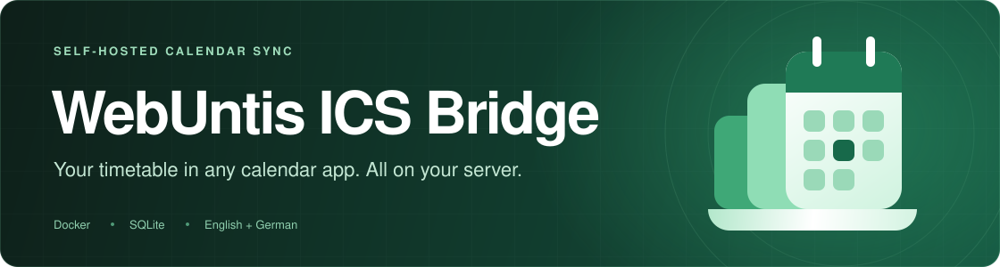
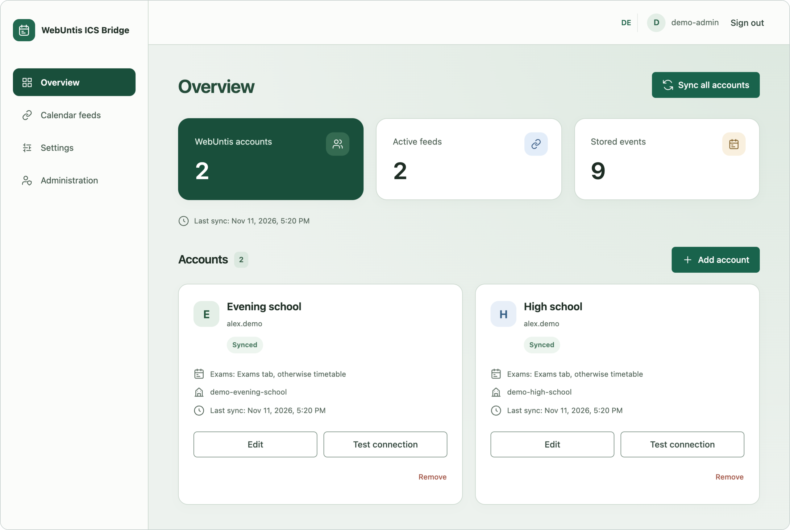
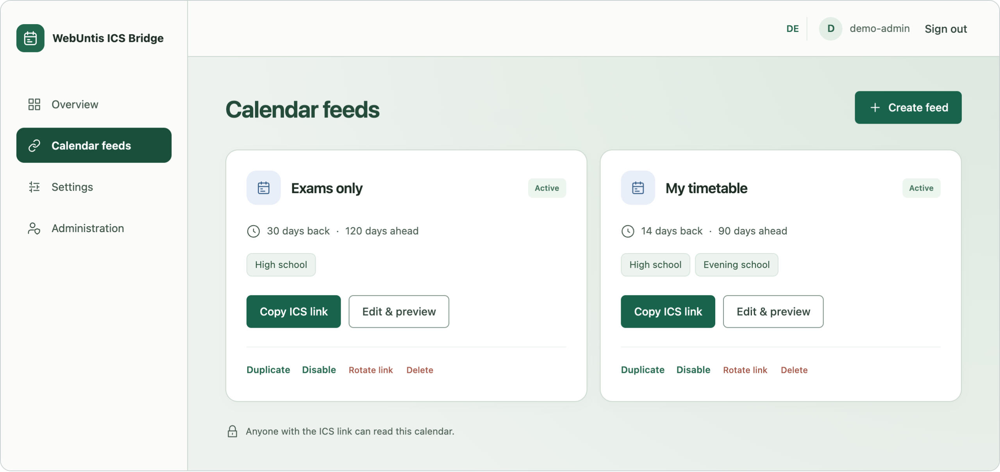
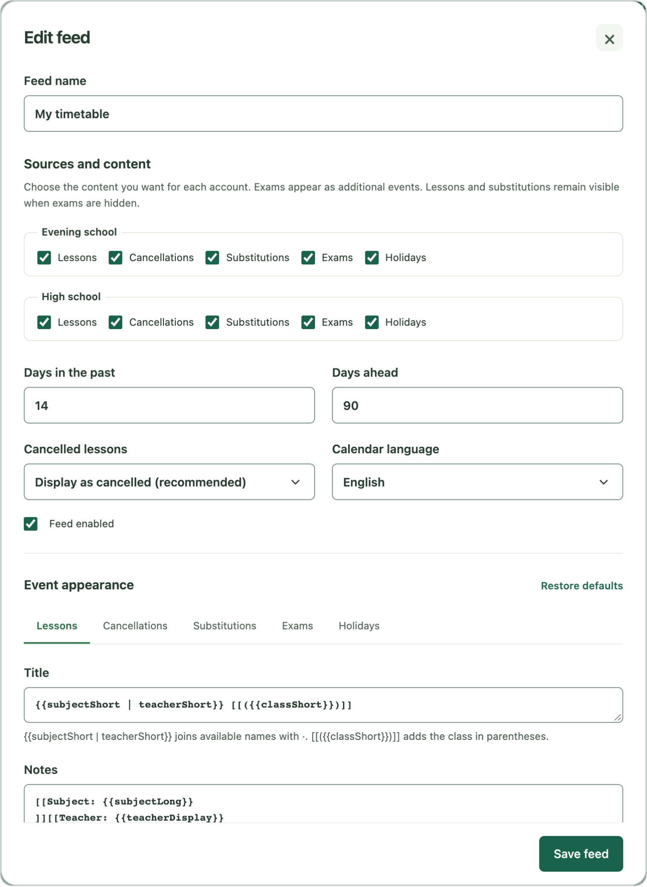

<p align="center">
  
</p>

<p align="center">
  <a href="#installation"><strong>Get started</strong></a> &nbsp;·&nbsp;
  <a href="#features">Features</a> &nbsp;·&nbsp;
  <a href="#first-steps">First steps</a> &nbsp;·&nbsp;
  <a href="#updates-and-backups">Update &amp; back up</a> &nbsp;·&nbsp;
  <a href="#configuration">Configure</a> &nbsp;·&nbsp;
  <a href="https://github.com/14flavius/webuntis-ics-bridge/releases">Releases</a>
</p>

<p align="center"><sub>Private user accounts &nbsp;·&nbsp; Custom calendar feeds &nbsp;·&nbsp; Encrypted credentials</sub></p>

<a name="preview"></a>

<p align="center">
  <a href=".github/screenshots/dashboard.png">
    
  </a>
</p>
<p align="center"><sub>Your accounts, feeds and last sync at a glance. Screenshots use example data.</sub></p>

<details>
<summary><strong>A closer look at calendar feeds</strong></summary>
<br>
<p align="center">
  <a href=".github/screenshots/feeds.png">
    
  </a>
</p>

</details>

<details>
<summary><strong>A closer look at the feed editor</strong></summary>
<br>
<p align="center">
  <a href=".github/screenshots/feed-editor.png">
    
  </a>
</p>

</details>

> [!IMPORTANT]
> Unofficial and independent of Untis. The bridge uses school-dependent internal
> WebUntis interfaces, not the registered Platform API.

> [!NOTE]
> Tested without problems with student accounts at three different schools.
> WebUntis instances differ in features and permissions, so another school may
> behave differently. If yours does, please
> [open an issue](https://github.com/14flavius/webuntis-ics-bridge/issues).

## Features

<table width="100%">
  <tr>
    <td width="50%" valign="top">
      <h3>Timetable sync</h3>
      <p>Lessons, cancellations, substitutions, exams and holidays are synchronized in the background and stored on your server.</p>
    </td>
    <td width="50%" valign="top">
      <h3>Calendar feeds</h3>
      <p>Subscribe in Apple Calendar, Google Calendar, Outlook or another ICS-compatible calendar. Create as many feeds as you need.</p>
    </td>
  </tr>
  <tr>
    <td width="50%" valign="top">
      <h3>Multiple accounts</h3>
      <p>Combine several students in one feed and choose the event types for each account separately.</p>
    </td>
    <td width="50%" valign="top">
      <h3>Exams as extra entries</h3>
      <p>An exam gets its own calendar event. The lesson stays visible, even in feeds that hide exams.</p>
    </td>
  </tr>
  <tr>
    <td width="50%" valign="top">
      <h3>Event templates</h3>
      <p>Write your own titles, notes and locations with variables and optional blocks. A live preview uses your synchronized events.</p>
    </td>
    <td width="50%" valign="top">
      <h3>Private by design</h3>
      <p>Separate user accounts with admin-managed roles, optional two-factor authentication, encrypted WebUntis passwords and revocable feed links. No cloud, no telemetry.</p>
    </td>
  </tr>
</table>

The interface is available in English and German. Original school texts stay unchanged.

## Installation

Requires **Docker with Compose v2**, **curl** and **OpenSSL**. Docker images are
available for **amd64 and arm64**; no Node.js installation is needed on the host.

### 1. Install

Run the installer in a new directory:

```sh
mkdir -p webuntis-ics-bridge
cd webuntis-ics-bridge
curl -fSL --proto '=https' --proto-redir '=https' \
  https://raw.githubusercontent.com/14flavius/webuntis-ics-bridge/main/scripts/install.sh \
  -o install.sh &&
sh install.sh
```

Follow the prompts for the instance name, browser URL, port and listen address.
Use the exact URL you will open in your browser, including `https://` behind a
reverse proxy. The installer creates the configuration and starts the bridge.
For an existing installation, follow [Updates and backups](#updates-and-backups).

### 2. Create your administrator

Open the URL you configured during installation and choose a username and a
password of at least 12 characters. The first account becomes the administrator.

> [!IMPORTANT]
> Setup is open for two hours after the first start. If it expires, run
> `docker compose restart bridge` to open a new window.

Create more accounts and manage roles in **Administration**. There is no public
registration; administrators cannot view another user's WebUntis accounts, events
or calendar links. Personal settings, including two-factor authentication, are
under **Settings**.

## First steps

1. **Add a WebUntis account.** On **Overview**, choose **Add account**, search for
   your school and enter the _student_ login. **Test connection** checks the login
   before anything is saved.
2. **Create a feed.** Under **Calendar feeds**, choose the accounts and what each
   one contributes: lessons, cancellations, substitutions, exams and holidays.
3. **Subscribe.** Copy the **ICS link** and add it to your calendar app as an
   internet calendar subscription.

> [!IMPORTANT]
> Anyone with the ICS link can read that calendar. Use **Rotate link** to revoke an old link.

## Updates and backups

### Update

Back up and update from your installation directory:

```sh
sh scripts/backup.sh && docker compose pull && docker compose up -d --wait
```

Keep your existing `.env` and `data/` directory. Accounts, feeds and events are
retained; database migrations run automatically on startup. If you pin an image
version, update `BRIDGE_IMAGE` first. New images are available once the
[release build](https://github.com/14flavius/webuntis-ics-bridge/actions/workflows/docker-publish.yml) finishes.

### Back up

To create a backup without updating:

```sh
sh scripts/backup.sh
```

The backup asks for a passphrase, takes a consistent snapshot while the bridge
keeps running and creates a folder in `backups/`. It holds the encrypted database
with both secrets, `docker-compose.yml.backup` and the image ID, and is marked
`COMPLETE` when finished. Keep a protected copy outside the server; the passphrase cannot
be recovered. The database lives in `./data`; preserve this directory when replacing
containers.

<details>
<summary><strong>Restore a backup</strong></summary>

Only use a backup folder marked `COMPLETE`. Decrypting it needs a
[development checkout](#development) with Node.js 24. Restore into a **new,
nonexistent directory**:

```sh
node scripts/backup.mjs restore <backup-file> <new-directory>
```

This writes `<new-directory>/.env` and `<new-directory>/data/bridge.sqlite`. Copy
`BETTER_AUTH_SECRET` and `ENCRYPTION_KEY` from the restored `.env` into the `.env`
of your installation, restore `docker-compose.yml.backup` as
`docker-compose.yml`, stop the bridge and place the restored database at
`data/bridge.sqlite`, owned by UID/GID `1000`. Verify the restored
installation before deleting anything.

</details>

## Configuration

Edit `.env` in your installation directory, then apply changes:

```sh
docker compose up -d --pull never --wait
```

| Setting        | Purpose                                                                                         |
| -------------- | ----------------------------------------------------------------------------------------------- |
| `PUBLIC_URL`   | Full browser URL, such as `https://calendar.example.com`. Subpaths are not supported.           |
| `HOST_PORT`    | Published HTTP port on the host, usually `3000`.                                                |
| `BIND_ADDRESS` | `127.0.0.1` for local access or a proxy on the same host; `0.0.0.0` for LAN access.             |
| `BRIDGE_IMAGE` | Optional fixed image, e.g. `ghcr.io/14flavius/webuntis-ics-bridge:1.0.1`. Defaults to `latest`. |

Keep the generated `BETTER_AUTH_SECRET`, `ENCRYPTION_KEY` and `COMPOSE_PROJECT_NAME`
unchanged. For HTTPS, terminate TLS at your reverse proxy and forward to the
bridge's HTTP port. Plain HTTP is only accepted for `localhost` and `127.0.0.1`;
every other address needs HTTPS. A proxy in another container needs network access
to the bridge; its localhost is separate from the host's.

<details>
<summary><strong>Reverse proxy examples (nginx, Apache)</strong></summary>

Both examples forward `https://calendar.example.com` to a bridge listening on
`127.0.0.1:3000` and keep feed links out of the access log. Replace the domain,
port and certificate paths with your own, and set
`PUBLIC_URL=https://calendar.example.com` in `.env`. They are starting points and
have not been tested against every setup.

**nginx**

```nginx
server {
    listen 80;
    server_name calendar.example.com;
    return 301 https://$host$request_uri;
}

server {
    listen 443 ssl;
    http2 on;
    server_name calendar.example.com;

    ssl_certificate     /etc/letsencrypt/live/calendar.example.com/fullchain.pem;
    ssl_certificate_key /etc/letsencrypt/live/calendar.example.com/privkey.pem;

    proxy_set_header Host              $host;
    proxy_set_header X-Forwarded-For   $proxy_add_x_forwarded_for;
    proxy_set_header X-Forwarded-Proto $scheme;

    location / {
        proxy_pass http://127.0.0.1:3000;
    }

    # Feed links are secrets: do not write them to the access log.
    location /feed/ {
        access_log off;
        proxy_pass http://127.0.0.1:3000;
    }
}
```

**Apache** (needs `mod_ssl`, `mod_proxy`, `mod_proxy_http`, `mod_headers` and `mod_setenvif`)

```apache
<VirtualHost *:80>
    ServerName calendar.example.com
    Redirect permanent / https://calendar.example.com/
</VirtualHost>

<VirtualHost *:443>
    ServerName calendar.example.com

    SSLEngine on
    SSLCertificateFile    /etc/letsencrypt/live/calendar.example.com/fullchain.pem
    SSLCertificateKeyFile /etc/letsencrypt/live/calendar.example.com/privkey.pem

    ProxyPreserveHost On
    ProxyPass        / http://127.0.0.1:3000/
    ProxyPassReverse / http://127.0.0.1:3000/
    RequestHeader set X-Forwarded-Proto "https"

    # Feed links are secrets: do not write them to the access log.
    SetEnvIf Request_URI "^/feed/" no_log
    CustomLog ${APACHE_LOG_DIR}/access.log combined env=!no_log
</VirtualHost>
```

</details>

The sync interval is under **Settings** and can be changed by administrators.
See [`docker-compose.yml`](docker-compose.yml) for all deployment options.

## Help

Questions or problems? [Open an issue](https://github.com/14flavius/webuntis-ics-bridge/issues).
For startup problems, check `docker compose logs --tail=100` and
`docker compose ps`. Remove secrets, feed links and personal information before
sharing logs. Found a security problem? Report it privately as described in
[SECURITY.md](SECURITY.md).

## More

<details>
<summary><strong>Event templates</strong></summary>

Each feed has a title, notes and location template for every event type:

```text
Title:    {{subjectShort | teacherShort}} [[({{classShort}})]]
Notes:    [[Subject: {{subjectLong}}]] [[Note: {{info}}]]
Location: {{roomShort}}
```

`{{a | b}}` joins the values that exist, for example `MA · TA` or just `MA`. A
`[[...]]` block disappears when a value inside it is missing. Templates are plain
text; nothing is executed.

Variables: `subject`, `teacher`, `room`, `class`, `info`, `status`,
`substituteTeacher`, `originalTeacher`, `examType`, `examName`, `examText`,
`holidayName`, `account`, `date`, `start`, `end`. The first four and both teacher
variants are also available with a `Short`, `Long` or `Display` suffix, for
example `{{teacherShort}}`.

</details>

<details>
<summary><strong>Exam source and cancelled lessons</strong></summary>

Choose the exam source for each account:

| Option           | Behavior                                                                            |
| ---------------- | ----------------------------------------------------------------------------------- |
| Prefer Exams tab | Uses the WebUntis Exams tab and falls back to timetable exams if it is unavailable. |
| Timetable        | Uses only timetable entries that are marked as exams.                               |

Choose how each feed handles cancelled lessons:

| Option               | Behavior                                                            |
| -------------------- | ------------------------------------------------------------------- |
| Display as cancelled | Keeps the event with a cancellation title. Recommended.             |
| Hide                 | Leaves cancelled lessons out.                                       |
| Send CANCELLED       | Sends `STATUS:CANCELLED`. Some calendar apps then remove the event. |

</details>

<details>
<summary><strong>Multiple instances</strong></summary>

Use a separate directory, instance name and host port for each instance. Use
separate hostnames for independent browser logins; cookies are shared across
ports on the same hostname.

</details>

<details>
<summary><strong>Security details</strong></summary>

- Passwords are hashed by Better Auth. Sessions use HTTP-only cookies, origin checks and rate limiting.
- WebUntis passwords are encrypted with AES-256-GCM under a separate key and are never returned by the API.
- The bridge only connects to HTTPS hosts under `*.webuntis.com`. Private addresses and redirects are rejected.
- Feed links are 256-bit secret tokens. Reading a feed never contacts WebUntis. Avoid logging `/feed/` URLs at your proxy.
- The container runs without root, with a read-only filesystem and no extra capabilities.

</details>

<details>
<summary><strong>Known limitations</strong></summary>

- Student username and password accounts on `*.webuntis.com` only. No SSO, parent or teacher accounts.
- WebUntis interfaces differ per school and can change without notice. Unexpected responses are rejected and existing data is kept.
- An empty exam or holiday response cannot prove a deletion, so a removed event can stay until it leaves the feed window.
- Users cannot share accounts or feeds with each other. Share the ICS link instead.
- No homework, external holiday calendars, subject filters or manual events.

</details>

## Development

<details>
<summary><strong>Run locally and check your changes</strong></summary>

Use **Node.js 24**. The app uses TypeScript, Fastify, React, Vite, Tailwind,
Better Auth and SQLite.

```sh
git clone https://github.com/14flavius/webuntis-ics-bridge.git
cd webuntis-ics-bridge
bash scripts/setup.sh
npm ci --ignore-scripts
npm run dev
```

Open `http://127.0.0.1:5173`. Checks: `npm run typecheck`, `npm run lint`,
`npm run format:check`, `npm test`, `npm run build`. Browser flows run with
`npm run test:browser` and need a local Chrome. `npm run screenshots` regenerates
the README screenshots from example data.

To try your own image, build it and point the Compose file at it:
`docker build -t bridge:local .`, then set `BRIDGE_IMAGE=bridge:local` in `.env`
and start with `docker compose up -d --pull never --wait`.

</details>

---

<p align="center">
  <a href="#installation">Install WebUntis ICS Bridge</a> &nbsp;·&nbsp;
  <a href="https://github.com/14flavius/webuntis-ics-bridge/issues">Get help</a> &nbsp;·&nbsp;
  <a href="LICENSE">MIT License</a>
</p>
<p align="center">
  By <a href="https://flavius-hager.de">Flavius Hager</a><br>
  <sub>Not affiliated with or endorsed by Untis.</sub><br>
  <sub>Most of the original WebUntis ICS Bridge foundation was vibe-coded with AI assistance.</sub>
</p>
